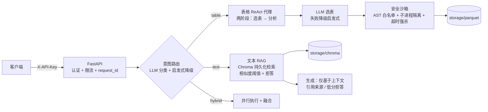

# Smart Emergency QA — 应急管理安全生产智能问答（企业级）

面向危化品应急管理场景的混合问答服务：**结构化表数据（17 张 Excel）+ 非结构化文本（政策法规/标准规范）**，提供带安全沙箱、认证限流、健康探针、评测闭环的 REST API。

> 本目录下 `baseline/` 与 `advance/` 为竞赛原型（Datawhale 秋训营），保留作对照；`app/` 是按企业级要求重写的生产版本。两者的关键差异见 [设计决策](#设计决策)。

## 架构



```
app/
├── main.py               # FastAPI 入口：装配、request_id 中间件、统一错误体
├── core/                 # 配置(pydantic-settings) / JSON 日志 / 异常体系
├── llm/client.py         # OpenAI 兼容客户端：超时、指数退避重试、embedding 缓存(sqlite)
├── rag/                  # chunking(标题层级分块) / ingest(索引构建) / retriever / generator
├── tabular/              # loader(xlsx→parquet) / schema(两阶段元数据) / sandbox / agent(ReAct)
├── orchestrator/         # router(意图路由) / pipeline(编排：分支/并行/融合/总超时)
└── api/                  # schemas / security(API Key + 滑动窗口限流) / routes(含探针)
eval/                     # 评测集(18题四类) / 指标(对齐竞赛公式) / 报告脚本
tests/                    # 64 项测试：沙箱攻击载荷 26 条全部拦截 + API 合约 + 路由降级 + 分块 + 解析边界
scripts/build_index.py    # 索引构建 CLI（与服务启动分离）
```

## 快速开始

```bash
# 1. 安装依赖（Python >= 3.10）
pip install -e ".[dev]"   # 或按 pyproject.toml dependencies 手动安装

# 2. 配置环境
cp .env.example .env      # 填入 OPENAI_API_KEY（硅基流动等 OpenAI 兼容服务）

# 3. 构建索引（一次构建，服务端只读加载）
python -m scripts.build_index

# 4. 启动服务
python -m uvicorn app.main:app --host 0.0.0.0 --port 8000

# 5. 验证
curl http://127.0.0.1:8000/api/v1/ready
curl -X POST http://127.0.0.1:8000/api/v1/qa \
     -H "Content-Type: application/json" -H "X-API-Key: <你的key>" \
     -d '{"question": "涉及重氮化工艺的企业数量？"}'

# 测试 / 评测
python -m pytest tests/
python eval/run_eval.py
```

Docker 部署（数据与构建产物挂载在宿主机，镜像无状态）：

```bash
cp .env.example .env && vim .env
docker compose up -d --build
docker compose exec qa python -m scripts.build_index   # 首次构建索引
```

## API

| 方法 | 路径 | 认证 | 说明 |
|---|---|---|---|
| POST | /api/v1/qa | 需要 | 问答（question: 2-500 字） |
| GET | /api/v1/health | 免认证 | 存活探针（liveness） |
| GET | /api/v1/ready | 免认证 | 就绪探针（索引/表数据/LLM 配置检查） |

完整交互文档见运行时 Swagger UI：`/docs`。

请求/响应示例：

```json
// POST /api/v1/qa
{"question": "2025年3月22日开停车企业数量？"}
// 响应
{
  "answer": "2025年3月22日开停车企业数量为 N 家。依据：v_work 表 ...",
  "route": "table",            // text | table | hybrid
  "sources": [...],            // 文本 chunk（含相似度分数）或表名
  "refused": false,            // 检索无证据时为 true（明确拒答而非编造）
  "latency_ms": 13750,
  "request_id": "e37d07434d35" // 与响应头 X-Request-ID 一致，日志可全链路检索
}
```

错误体统一为 `{"error": {"code": "...", "message": "..."}}`，不泄漏堆栈（完整堆栈只写日志）。

## 安全模型

### 1. LLM 生成代码的沙箱执行（本项目核心差异点）

竞赛原型 `advance/ReAct_Agent.py` 直接 `exec()` LLM 生成的代码且注入 `os` 模块——提示注入即可任意执行系统命令。生产版实施**三层防护**（经独立红队审查迭代：黑名单方案被实测绕过——`np.memmap` 任意文件读、`pd.io.common.os` 赋值别名链读 secret + `execve` 命令执行——故核心改为能力白名单模型）：

**第一层：AST 静态校验**（`validate_code`）
- 禁止 `import` / `global` / `nonlocal`；
- 禁止一切下划线属性（阻断 `__class__` / `__globals__` / `__import__` 逃逸链）；
- 属性黑名单：`system` / `execve` 族 / `memmap` / `read_*` / `to_csv` / `urlopen` 等文件/网络/进程原语；
- 连续属性链深 ≤ 2（挡 `pd.io.common.os.environ` 直链）；
- 名字白名单：仅 `pd` / `np` / `dfs` + 纯函数内建 + 异常类 + 已赋值变量。

**第二层：运行时白名单命名空间**（子进程 `globals`）
- 子进程中的 `pd` / `np` **不是模块本体**，是 curated `SimpleNamespace`（仅 DataFrame/merge/to_datetime、array/mean/linalg 等分析函数）——`pd.io` / `np.memmap` / `np.core` 物理不存在，赋值别名绕过（`c = pd.io.common; c.os`）在运行时必然 `AttributeError`；
- `__builtins__` 同为白名单字典。即使 AST 层被完全绕过，可达能力面仍是封闭集合。

**第三层：进程隔离与资源限制**
- 独立子进程执行（Docker 内非 root 用户），超时强杀（默认 30s），输出截断，表数据惰性加载。

验证：`tests/test_sandbox.py` 26 条攻击载荷（动态导入、dunder 逃逸、numpy 文件原语、赋值别名链、进程执行族等）静态或运行时全部拦截；合法 pandas/numpy 分析（含 `np.linalg.norm`、`.str.contains`、`try/except`）正常执行；死循环被超时终止；执行错误返回 traceback 供 ReAct 自愈。

**已知边界（如实声明）**：子进程以容器用户权限运行；若需要对抗国家级攻击者，应叠加 OS 级降权（seccomp/AppArmor/Job Object），当前威胁模型（提示注入驱动的 LLM 代码逃逸）下三层防护已封闭已知攻击面。

### 2. API 边界防护
- `X-API-Key` 认证，多 key 逗号分隔（支持轮换）；未配置 key 时认证关闭（仅限本地开发，日志明示）；
- 每 key 滑动窗口限流（默认 20 次/分钟，超出返回 429 + 重试等待时间）；
- 入参长度边界校验（2-500 字），异常统一兜底，堆栈不外泄。

### 3. 幻觉防护（安全场景硬要求）
- 检索相似度低于阈值（默认 0.35）→ 明确拒答，不调用 LLM 编造；
- 生成 prompt 强约束"仅基于参考资料作答 + 引用来源编号"；
- 拒答类评测题目（知识库外问题）以"明确拒答得 1 分、编造得 0 分"考核。

## 可靠性设计

| 机制 | 实现 |
|---|---|
| LLM 重试 | 超时/连接错误/429 指数退避重试（最多 4 次），全部集中在 `llm/client.py` 一处 |
| 路由降级 | LLM 分类失败 → 关键词启发式路由（永不抛异常） |
| 选表降级 | LLM 选表失败 → 2-gram 重合度启发式选表 |
| 分支容错 | hybrid 双路任一失败，另一路照常返回（响应标记 degraded） |
| 总超时 | 单问题 120s 硬上限，防资源占用 |
| 自愈闭环 | 沙箱执行错误 traceback 回填下一轮 ReAct 迭代 |
| 可观测 | JSON 结构化日志 + request_id 全链路贯穿（响应头可回传客户端指定 ID） |
| 探针 | liveness 与 readiness 分离，就绪检查覆盖索引/表数据/LLM 配置 |

## 性能设计

| 问题 | 方案 | 效果 |
|---|---|---|
| 每次启动重建向量索引 | Chroma `PersistentClient` + 索引构建 CLI 与服务分离 | 重启秒级加载，embedding 不重复计算 |
| 每次执行重新解析 17 张 xlsx | xlsx 一次性预转 parquet，沙箱内惰性加载 | openpyxl 解析只发生一次 |
| embedding 重复调用 | sqlite 磁盘缓存（key = 模型+文本哈希） | 增量构建近乎免费 |
| 全量 schema（2.3 万 token）注入 | 两阶段代理：LLM 先选表（1-2s），只注入所选表画像 | prompt 缩小一个数量级，7B 时代曾因此超时 → 修复后表格链路 12-14s |

## 设计决策（面试可讲）

1. **为什么 ReAct 文本协议而不是 function calling？**
   实测硅基流动 Qwen2.5-7B 的 `tool_calls` 输出为不可解析的伪 JSON（乱码 + 重复 token，单次 26s+）。改为 `Thought/Action/Action Input` 三行文本协议 + 正则解析后完全可控。协议解析失败有明确的自纠错反馈路径。
2. **为什么 72B 而不是免费 7B？**
   表格代理是多约束代码生成任务（业务过滤规则 + 真实列名 + 跨表关联），7B 错误率不可接受（幻觉列名/引号错配/日期乱码）。72B 单次问答成本约几分钱，质量决定可用性。模型名通过 `.env` 可切换，客户端无绑定。
3. **为什么子进程沙箱而不是线程？**
   Python 线程无法安全强杀（GIL），死循环会拖垮整个服务；`multiprocessing` + `terminate()` 提供确定性隔离边界。Windows spawn 模式有启动开销（约 1s），以正确性换性能，业务可接受。
4. **为什么两阶段表格代理（选表 → 分析）？**
   17 张表全量 schema 约 2.3 万 token：小模型超时，大模型贵且慢。选表是一段轻量 JSON 任务（1-2s），后续 prompt 缩小一个数量级。失败还有启发式兜底。
5. **为什么"构建"与"服务"分离？**
   索引构建（解析/分块/embedding）是批处理任务，服务启动是交互路径；二者耦合导致每次重启浪费数分钟与 token（竞赛原型的主要性能缺陷）。

## 评测

```bash
python eval/run_eval.py                # 全量 18 题
python eval/run_eval.py --category table
```

指标对齐竞赛公式 `0.7×关键词命中 + 0.3×语义相似度`；refuse 类以"明确拒答"计分。报告输出至 `eval/reports/report-<时间戳>.md`，含分类汇总、路由正确率、低分用例明细——作为 prompt/参数改动的 A/B 基线。

### 基线结果（Qwen2.5-72B-Instruct，2026-08-17）

| 类别 | 题数 | 平均分 | 路由正确率 |
|---|---|---|---|
| text | 8 | 0.733 | 8/8 |
| table | 6 | 0.850 | 6/6 |
| hybrid | 2 | 0.850 | 2/2 |
| refuse | 2 | 0 → **1.000**（修复后复测） | 路由不适用 |

- **意图路由 18/18 全对**（LLM 分类 + 启发式降级从未触发误路由）；
- 首轮总分 0.704，主要失分点：① refuse 类模型已文本拒答但 `refused` 标志未置位（已修复：`generator` 检测拒答话术置位 + 指标兜底，复测 2/2 满分，估算总分 ~0.815）；② 个别 text 题检索未命中目标文档（如 GB30871 动火分级），属于检索质量优化空间（候选方向：rerank、HyDE、按法规名构建元数据过滤）；
- 已知退化风险：hybrid 题若表格分支代码混入中文标点，自愈循环最多 8 轮（沙箱错误反馈已增加中文标点修正提示）。

## 已知限制（如实声明）

- `.wps` / 老 `.doc` 格式无法解析，索引构建时记录并跳过（当前 22 篇文本中 15 篇可解析，633 分块）；
- 限流状态存于进程内存，多实例部署需换 Redis（接口已收敛在 `api/security.py`，替换面小）；
- 评测集为自建近似（关键词均权），不代表竞赛官方真实得分；
- Windows 下沙箱子进程使用 spawn 启动，单次执行约 1s 额外开销；
- `advance/` 原型仍使用 `exec()` 直执行 + `os` 注入，仅保留作对照，勿在生产引用。

## 与竞赛原型（advance/）的差异清单

| 维度 | advance 原型 | 本生产版 |
|---|---|---|
| 代码执行 | `exec()` + 注入 `os` | AST 白名单 + 子进程沙箱 + 超时强杀 |
| 索引 | Chroma 内存客户端，每次重建 | PersistentClient + 构建分离 + embedding 缓存 |
| 表格数据 | 每次循环 `read_excel` | parquet 预转换 + 惰性加载 |
| 服务形态 | 脚本批处理 answer.csv | FastAPI REST + 认证 + 限流 + 探针 |
| 错误处理 | print 继续 | 统一异常体系 + JSON 错误体 + request_id 日志 |
| 意图路由 | 每题一个全量 ReAct 循环 | LLM 单次分类 + 启发式降级 |
| 质量 | 无度量 | 18 题评测集 + 报告，改动可 A/B |
| 测试 | 无 | 64 项（含 26 条沙箱攻击载荷，经独立红队审查后加固） |
