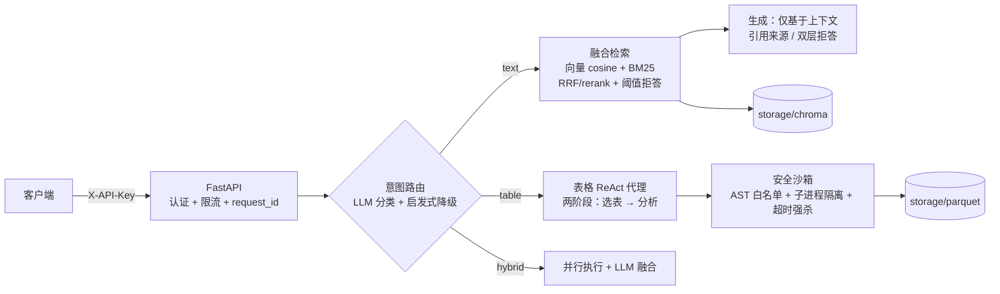

# 01 · 项目概览与整体架构

## 1. 项目定位

面向危化品应急管理领域的智能问答服务，处理两类异构数据源：

- **非结构化文本**：安全生产法规、国家标准、监管文件（PDF/docx）→ 走 RAG 检索链路
- **结构化表格**：17 张业务表（企业/仓库/特殊作业/预警等，Excel）→ 走 Text-to-Pandas 代码生成链路

一个问题进来，系统先做**意图路由**（text/table/hybrid），再分发到对应链路，hybrid 双路并行后融合。这是"混合问答"（Hybrid QA）的典型架构：知识在文档里的问检索，知识在数据库里的问代码。

**项目性质（如实）**：基于 Datawhale 秋训营赛题的本地化复现与工程化优化，1 人 + AI 协作开发（OPC 模式），未参与官方比赛，未上线（本地端到端验证通过）。

## 2. 数据资产（本人实测）

| 数据 | 规模 | 说明 |
|---|---|---|
| 文本语料 | 20 个文件，15 篇入索引 | 5 篇 `.doc/.wps` 格式不支持，构建时记录跳过 |
| 向量索引 | 710 分块 | Chroma 持久化，cosine 空间 |
| 其中 OCR 新增 | 4 篇扫描版 PDF | GB30871 等核心规范，pypdf 提取 0 字符，OCR 兜底入索引 |
| 表格数据 | 17 张 xlsx → parquet | 最大表 `enterprise_promise` 26 万行×52 列 |
| 表结构元数据 | 2 份 docx（约 2.3 万字符） | 解析为"列名→描述"字典，按需注入 prompt |

## 3. 整体架构



一次 `POST /api/v1/qa` 的完整流转：

1. **中间件层**（`app/main.py`）：生成/透传 `X-Request-ID`，注入日志上下文
2. **认证限流**（`app/api/security.py`）：`X-API-Key` 常数时间比较 + 每 key 滑动窗口（20 次/分钟）
3. **意图路由**（`app/orchestrator/router.py`）：LLM 单次分类，失败降级关键词启发式
4. **分支执行**（`app/orchestrator/pipeline.py`）：text/table 单路或 hybrid 并行，120s 总超时
5. **响应**：统一 JSON（answer/route/sources/refused/latency_ms/request_id/**usage**），错误统一为 `{"error": {"code", "message"}}`

另有 `POST /api/v1/qa/stream`（SSE）流式接口：阶段事件 routing→route→working→answer，首事件 <1s，消除长文本问答的静默等待（见 [06 章](06-编排与API层.md)）。

## 4. 三层架构与依赖方向

```
app/
├── main.py / api/          # ① API 装配层：路由、认证、中间件、错误体
├── orchestrator/            # ② 编排层：意图路由、分支调度、融合、注入防护
│   ├── router.py            #    只依赖 llm（分类）
│   ├── pipeline.py          #    依赖 rag/* 与 tabular/*（分支 + 阶段事件流）
│   └── guard.py             #    输出侧 prompt 泄露检测（业务层，不进 core）
├── rag/                     # ③ 领域能力层 A：文本检索
│   ├── chunking.py / ingest.py / bm25.py / retriever.py / generator.py
├── tabular/                 # ③ 领域能力层 B：表格分析
│   ├── loader.py / schema.py / sandbox.py / agent.py
├── llm/                     # ④ 基础设施层：LLM 统一客户端（chat/rerank/embed + 缓存 + usage 观测）
└── core/                    # ④ 基础设施层：配置 / 日志 / 异常
```

依赖规则（实际执行的约定）：
- **llm 收口**：所有 LLM API 调用只经 `app/llm/client.py` 一处，业务模块禁止散落 SDK 调用——重试/降级策略只有一份实现
- **编排不碰细节**：`pipeline.py` 只调 `Retriever.retrieve` / `TabularAgent.run` 等高层接口
- **core 无业务**：配置/日志/异常不 import 任何业务模块

## 5. 与竞赛原型（advance/）的差异

竞赛原型是脚本式批处理（跑 answer.csv），生产版 `app/` 的关键改造：

| 维度 | advance 原型 | 生产版 |
|---|---|---|
| 代码执行 | `exec()` 直接执行 LLM 代码 + 注入 `os` 模块 | AST 白名单 + 子进程沙箱 + 超时强杀 |
| 意图路由 | 每题一个全量 ReAct 循环 | LLM 单次分类 + 启发式降级 |
| 索引 | Chroma 内存客户端，每次启动重建 | PersistentClient + 构建/服务分离 + embedding 缓存 |
| 检索 | 单路向量 top-k | 向量+BM25 融合 + rerank（多级降级） |
| 服务形态 | 脚本批处理 | FastAPI REST + SSE 流式 + 认证 + 限流 + 探针 |
| 错误处理 | print 继续 | 统一异常体系 + JSON 错误体 + request_id 日志 |
| 可观测 | 无 | token usage 观测 + 结构化日志 |
| 安全 | 仅沙箱防 LLM→代码 | 增加输入侧注入防护（结构隔离 + 输出检测） |
| 质量 | 无度量 | 18 题评测集（含 reference）+ 报告，改动可 A/B |
| 测试 | 无 | 172 项（含 30 条沙箱攻击载荷） |

> 沙箱改造的直接动因：原型 `advance/ReAct_Agent.py:43-77` 的 `exec()` 注入 `os`——提示注入即可任意执行系统命令。这是"demo"与"生产"的分界线。

## 6. 目录速查

```
Smart-Emergency-Response/
├── app/                    # 生产版服务（本文档主体）
├── advance/                # 竞赛原型（保留对照，勿生产引用）
├── baseline/               # 官方 baseline（保留对照）
├── eval/                   # 评测集/指标/报告/诊断工具
├── tests/                  # 172 项测试
├── scripts/build_index.py  # 索引构建 CLI
├── docs/wiki/              # 本 Wiki
├── Dockerfile / docker-compose.yml
└── pyproject.toml          # 依赖：fastapi/chromadb/openai/... + 可选 [ocr]
```

下一章 → [02-核心基础设施](02-核心基础设施.md)
